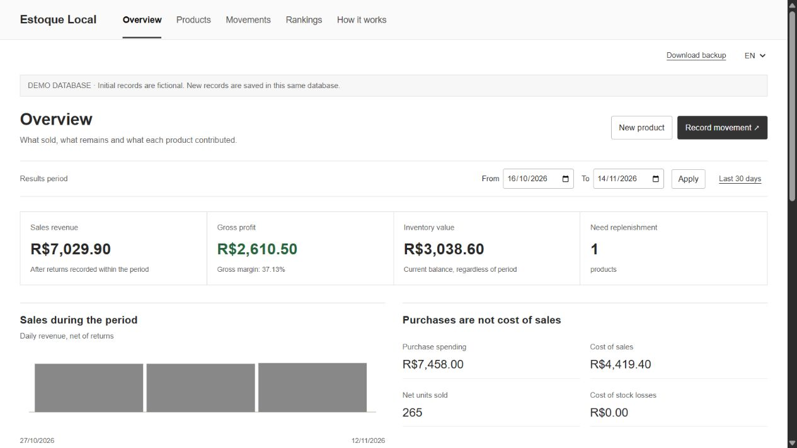

# Estoque Local

[Português](README.pt-BR.md)

Inventory management for a small shop, built with Python, FastAPI and SQLite.
Record purchases and sales, check what needs restocking and compare which
products sell most with which ones bring the most gross profit.

Includes partial sales returns, stock adjustments, date filters, seven rankings,
CSV exports and a Portuguese/English interface. It runs on your computer,
without accounts or an external service. Quantities are whole units and the
currency is BRL.



## Run

Use Python 3.11 or later. On Windows, open a terminal in this folder:

```powershell
python -m venv .venv
.\.venv\Scripts\python.exe -m pip install -r requirements.txt
.\.venv\Scripts\python.exe run.py
```

Open [127.0.0.1:8765](http://127.0.0.1:8765). Keep the terminal open while
using the app; Ctrl+C stops it. After setup, `start.cmd` also starts the app.
The PowerShell shortcut `./start.ps1 -Setup` creates the environment and installs
the dependencies for you.

On Linux/macOS, use `.venv/bin/python` instead of `.venv\Scripts\python.exe`.
If Python does not include `venv`, install `virtualenv` and create the environment
with `python -m virtualenv .venv`.

## First use

Add a product with its code, selling price and minimum stock. Record a purchase
with the quantity and unit cost. Then record sales as they happen; the balance
updates with each movement.

**Explore sample data** loads a fictional shop into an empty catalogue. Those
records stay in the same database as any entries you add later. To start a
separate clean database, stop the server and set a new path before launching:

```powershell
$env:ESTOQUE_DB = "data/my-shop.sqlite3"
.\.venv\Scripts\python.exe run.py
```

The original database remains where it was. Movements cannot be deleted or
backdated. Use a return to correct a sale, or a stock adjustment with a reason
for damage and counting differences.

## Backup

The default database is `data/stock.sqlite3`. **Download backup** makes a
consistent copy while the app is open. Keep copies outside this computer.

To restore: stop the server, preserve the current database, copy the backup to
the configured database path and restart. The app has no destructive restore
button. CSV exports are reports, not database backups; their monetary columns
are integer cents.

## About the calculations

SQLite keeps this local, single-user application in one file. Stock updates and
history entries commit together. Money is stored in cents, and a sale keeps its
historical cost even after a new purchase changes the average.

[See the calculations and an example](docs/DOMAIN_RULES.en.md).

Gross profit does not deduct rent, wages, sales taxes or fees. The
**How it works** page explains the indicators. Do not expose this app directly
to the internet: it has no login.

## Working on the code

Install `requirements-dev.txt`, then run `python -m pytest -q` in the virtual
environment. Node is only needed to check JavaScript syntax, not to run the app.
See [the contribution guide](CONTRIBUTING.md) for the commands.

The inventory rules are in `stock/ledger.py`, the HTTP API in `stock/web.py` and
the interface in `stock/static/`. Local databases and virtual environments stay
outside Git.
